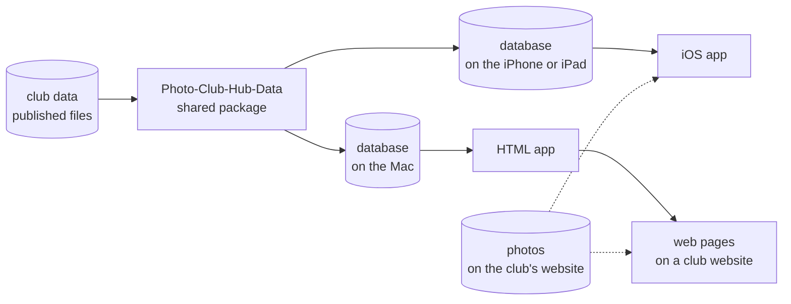

# Photo Club Hub

[🇳🇱  Nederlands](README_nl.md)

## What does it do?

Photo Club Hub shows the work of photo club members to audiences outside their club.
It is meant as a permanent online exhibition, showing a selection of each photographer's best work.
Unlike most photo sites, it is built around **clubs** rather than individual photographers:
clubs are where photographers already meet and exhibit together.
You can look up photographers directly, but you always see them as member of their clubs.
The clubs supply the data, and stay in full control of it.

Photo Club Hub aims to draw more visitors than club websites, which few people visit nowadays.
It also aims to provide a better viewing experience than social media, with its never-ending distractions.

Photo Club Hub comes as an app for iPhone and iPad, and as a web version that works in any browser,
on an Android phone or on a Windows or Mac computer.

## Where are we today?

- The [iOS app](https://apps.apple.com/nl/app/photo-club-hub/id1178324330?l=en) can be obtained via the App Store,
  and gets improvements and fixes about once a month.
- The [web version](https://www.fcdegender.nl/hub/en/clubs/) shows the same clubs and members in any browser,
  on any phone, tablet or computer. A club can add it to its own website with one menu link: on
  [Fotogroep De Gender's website](https://www.fcdegender.nl/), the "Ledenlijst" menu item leads to
  [its members in the web version](https://www.fcdegender.nl/hub/nl/clubs/fgDeGender/).
- A handful of clubs show their members and portfolios. Many more are visible on the map, ready for the next step.
- Clubs have supplied their data themselves, using a written guide. This confirmed that no special technical expertise was needed (although we plan to simplify this further in a future release).

## Where is this going?

Readers often judge by what they can see today, but today's version is part of a larger idea. So here are both side by
side.

| | Today | Goal |
| --- | --- | --- |
| Clubs | A handful show members and photos; many more are on the map. | Most photo clubs in the Netherlands showcase the work of their members, and gradually more countries join in. |
| Supplying data | Clubs edit a structured file, following a written guide, often with help. | A form, largely pre-filled (after the club's consent) from data the club already publishes: "check-and-correct". |
| Keeping it current | Only when someone notices something is incorrect. | Photo Club Hub checks for chanages on the club's existing website, and suggests a data update. |
| Exhibitions | Today Photo Club Hub doesn't support exhibitions yet. Clubs announce them on their own website, but people mostly learn about them by e-mails. Example: club secretary notifies nearby clubs, who can forward that to their members, who can make a note in their personal calendar.  | Each club's upcoming and past exhibitions in one place, visible in the app and on the web, so people can discover exhibitions near them without being on anyone's mailing list. Optionally with active app notifications for exhibitions in coming weeks by nearby/"followed" clubs. |
| Software maintenance | One very motivated volunteer, who built most of it before AI coding assistants were available. | A few volunteers, each looking after the features they made or care most about (likely using AI to make the work easier). |

## Why this can work, and why now

- **The chicken-and-egg problem can be broken from the data side.** With few clubs there is limited content, so
  few people use the app, which gives clubs little motivation to get onboard. The project does not wait for clubs
  to arrive: clubs are put on the map in advance, and a club can then claim its entry and we use smart software to
  advance the data, one level at a time.
- **Taking part comes in small steps.** Level 1: the club is on the map. Level 2: its current members are listed.
  Level 3: their portfolios can be viewed. Each level is useful on its own.
- **Software can take most of the typing off clubs.** Software has become far better at reading what a club
  already publishes. Instead of editing a file and fixing its errors, a club will get its data mostly filled in,
  and only has to check and correct it. We are not there yet, but this is where supplying data is heading.
- **Coding assistants lower the barrier for developers.** Joining an existing software project used to mean
  weeks of finding your way around the code. An assistant now explains in seconds where a value comes from,
  why a bug happens, or why the compiler warns about a risk. So a volunteer with a few hours a month can
  improve this project itself, rather than start a separate one.

## Principles

If you cannot live with these, this project is probably not for you.

- **Free, and open source.** Both apps are free, and all code is public under the MIT license.
- **Clubs own their data.** A club owns its data and can host it itself; alternatively, the project can host
  it on the club's behalf.
- **Photos stay with the club.** They are shown from the club's own website, never copied.
- **No accounts, and no revenue model.** Nobody signs up, nothing is sold, and nobody ends up tied to anything.
- **Adoption before features.** Without data the software has no value, so getting clubs on board comes before
  new features or fancier technology.
- **Made for people who are not technical.** Many club members are retired. Plain words, and features that can
  be used without help, count for more than what is technically possible.
- **Not limited to one federation or one country.** The emphasis is on the Netherlands for now; the design is
  not.
- **Other apps are welcome.** Anyone may build on this. Please talk to us before using the Photo Club Hub name.

## What we ask of you

| You are | We would ask you to | What you get back |
| --- | --- | --- |
| A supporter | tell your club about it, try it, and say what is missing | a say in what gets built next |
| A developer | pick up a ticket, and look after what you build | a real project with real users, in Swift |
| A club's data person | publish your club's member list, and fix it when someone reports a mistake | your club's work visible outside the club, with no website to build |
| A club's board | agree to take part, and name someone to supply the data | a showcase for the club, at no cost |

## Hard questions

These are the questions people ask, or think without asking. Answers are being written. Some of the
[FAQ's Policy section](https://github.com/vdhamer/Photo-Club-Hub/blob/main/Photo%20Club%20Hub/Documentation/FAQ_en.md#policy)
covers related ground: costs, privacy, control over photos, and whether it will still work in a few years.

1. The idea is great, but I see only a small number of photographers in the app, and it isn't growing. Why?
2. Maintaining JSON files is far too high a barrier for clubs. Why can't AI simply fill the app from the
   clubs' own websites?
3. How will clubs keep this up to date, when they struggle to keep even their own websites current?
4. I believe it can take off, but how do you break the chicken-and-egg problem: few users, so little value, so few users?
5. You built something only you can maintain. We can't afford to hire a company to take your place. What
   happens when you stop?
6. What does this add over the website a club already has?
7. What drives you to do this?

## How it works

### Built with

| Built with | iOS app | Web version | What it does |
| --- | :---: | :---: | --- |
| Swift and SwiftUI | ✅ | ✅ | the apps themselves (the web version is generated by a Mac app) |
| [Ignite](https://github.com/twostraws/Ignite) | | ✅ | turns the data into static web pages |
| Photo-Club-Hub-Data and Core Data | ✅ | ✅ | reads the published files into a database on each device |
| JSON files | ✅ | ✅ | the club data itself, readable by anyone |
| Lightroom and Juicebox Pro | ✅ | ✅ | how a club publishes its portfolios, on its own website |
| [Claude Code](https://code.claude.com/docs/en/overview) | ✅ | ✅ | help with coding, debugging and documentation |

### The four repositories

| Repository | What it holds | Tickets written as |
| --- | --- | --- |
| [Photo-Club-Hub](https://github.com/vdhamer/Photo-Club-Hub) | the iOS app, and the live club data | `iOS#123` |
| [Photo-Club-Hub-HTML](https://github.com/vdhamer/Photo-Club-Hub-HTML) | the Mac app that generates the web version | `HTML#123` |
| [Photo-Club-Hub-Data](https://github.com/vdhamer/Photo-Club-Hub-Data) | the package both apps share: data model and loaders | `Data#123` |
| Photo-Club-Hub-Project (this one) | work that is not code: the roadmap, the servers, planning | `Project#123` |

## Following along, and taking part

- **[The dashboard](https://github.com/vdhamer/Photo-Club-Hub-Project/discussions/14)** in this repository's Discussions
  shows what is being worked on, what comes next, and how that is decided. You can comment on it.
- **To get notified**, click Watch at the top of this page, or subscribe to the dashboard only.
- **No git or code needed** to comment on a ticket or a discussion: a free GitHub account and a browser will do.
- **`Good first issue`** marks tickets a newcomer can pick up.
- **Everything here is public.** Please don't write the names of club members in tickets or comments.

## Further information

- [FAQ](https://github.com/vdhamer/Photo-Club-Hub/blob/main/Photo%20Club%20Hub/Documentation/FAQ_en.md), for users and clubs
- [How a club supplies its member list](https://tinyurl.com/Level2creation) (Level 2 guide)
- [The iOS app's README](https://github.com/vdhamer/Photo-Club-Hub/blob/main/.github/README.md): Levels, the data model, installation
- [Where the data lives, and current plans](https://github.com/vdhamer/Photo-Club-Hub-Data/issues/56) (a one-screen overview)
- [Glossary](https://github.com/vdhamer/Photo-Club-Hub-Data/issues/48) of terms the data model does not hold (being written)
