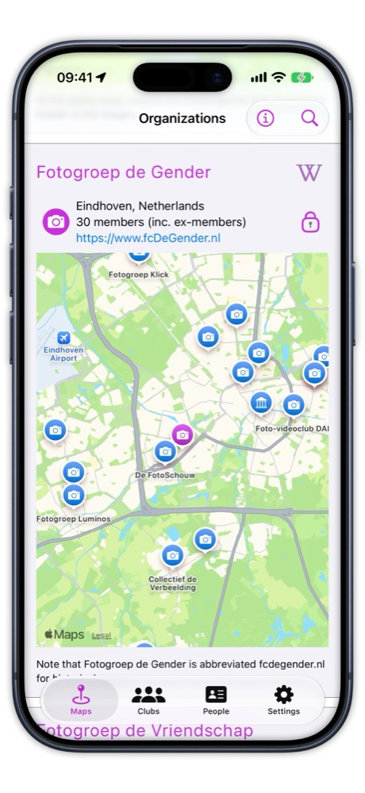

# Photo Club Hub

[🇳🇱  Nederlands](README_nl.md)

_Draft, 28 September 2026_

## What does it do?

Photo Club Hub shows the work of photo club members to people outside their club.
Think of it as a permanent online exhibition, with a selection of each photographer's best work.
Unlike most photo sites, it is built around **clubs**, not individual photographers:
clubs are where photographers already meet, discuss each other's work and exhibit together.
You can look up a photographer directly, but you always see them as a member of their club.
The clubs supply the data, and stay in full control of it.

We want it to draw more visitors than club websites, which few people visit nowadays.
And we want it to be a better place to look at photos than social media, with its endless distractions.

Photo Club Hub comes as an app for iPhone and iPad, and as a web version that works in any browser,
on an Android phone or on a Windows or Mac computer.

## Where are we today?

  
   
  <em>The map in the app, around Eindhoven. Every pin is a photo club (camera) or a museum (building). 
  Clubs you would otherwise find one website at a time appear side by side, one tap apart.</em>

- The [app](https://apps.apple.com/nl/app/photo-club-hub/id1178324330?l=en) for iPhone and iPad is in Apple's App Store,
  and gets improvements and fixes about once a month.
- A club can add the [web version](https://www.fcdegender.nl/hub/en/clubs/) to its own website with one link: on
  [Fotogroep De Gender's website](https://www.fcdegender.nl/), the "Ledenlijst" menu item leads to
  [the club's members in the web version](https://www.fcdegender.nl/hub/nl/clubs/fgDeGender/).
- A handful of clubs show their members and portfolios. Many more are on the map, ready for the next step.
  So far the map covers two regions of the Netherlands; the other regions are next.
- Several clubs have added their data themselves, using a written guide. We plan to make that easier.

## Where is this going?

What you see today is only part of the idea. Here are both, side by side.

| | Today | Goal |
| --- | --- | --- |
| Clubs | A handful show members and photos; many more are on the map, in two regions so far. | Most photo clubs in the Netherlands show their members' work, and clubs in other countries gradually join in. |
| Supplying data | Clubs edit a structured file, following a written guide. Some manage on their own, some need help. | A club gets a form that is largely filled in from its own website. It only has to check and correct it. |
| Keeping it current | Only when someone notices a mistake and gets it fixed. | Photo Club Hub compares the data with the club's website, and asks the club to confirm any changes. |
| Exhibitions | Photo Club Hub doesn't show exhibitions yet. Clubs announce them on their own website, but people mostly hear about them by e-mail: a club's secretary tells nearby clubs, who may pass it on to their members. | Each club's upcoming and past exhibitions in one place, in the app and on the web, so people find exhibitions near them without being on anyone's mailing list. The app could also remind you of exhibitions by nearby clubs, or by clubs you follow. |
| Software maintenance | One enthusiastic volunteer, who designed and built it, mostly before AI coding assistants existed. | A few volunteers, each looking after the parts they built or care about, with help from AI assistants. |

## Strategy to get the ball rolling

<!-- Draft diagram, to be redrawn. -->

- **Break the chicken-and-egg problem.** Few clubs means little to see. Little to see means few users.
  Few users means little reason for a club to join. So we don't wait for clubs to arrive: we put them on the map
  in advance, region by region. A club can then step up and, helped by smart software, take it from there.
- **Take part in small steps.** Each level adds something. Level 1: the club is on the map.
  Level 2: its members and their interests are listed. Level 3: their portfolios can be viewed.
- **Let software do most of the typing.** Software has become much better at reading what a club already
  publishes. Instead of editing a file and fixing its errors, a club gets its data mostly filled in, and only
  checks and corrects it. We're not there yet, but that's where we're heading.
- **Let AI help new developers.** Joining an existing software project used to mean days of finding your way
  around the code. An AI assistant now explains in seconds where a value comes from, what caused a bug, or why
  the build complains. So a volunteer can make a real improvement in a few hours.

## Principles

- **Free, and staying free.** Both apps are free, and will remain so. The project is run by volunteers.
- **Open source.** All code is public on GitHub, under the MIT license.
- **Clubs own their data.** A club can host its data itself, or let the project host it on its behalf.
- **Photos stay with the club.** They're shown from the club's own website, never copied.
- **No logins.** Nobody signs up or needs a password, and there's no central database to maintain.
  Changes to the data go through version control: suggested first, then approved.
- **Clubs first.** Without data, the software has no value. So getting clubs on board comes first, and anything
  that helps with that, like simpler data entry, comes right after. Simpler is better: fancy technology that adds
  complexity has to earn its place.
- **Made for people who aren't technical.** Many club members are "a bit older", and joined their club for
  photography, not to wrestle with software. So it has to be simple on the outside, even when that makes it
  harder on the inside.
- **Open to any club, anywhere.** Today's clubs are all in the Netherlands, but the design is international.
  A club doesn't need to belong to any organization, although we do seek alignment with organizations such as
  the Dutch Fotobond.
- **Other apps are welcome.** The shared "Data" part can be used to build other apps. Please talk to us before
  using the Photo Club Hub name, and credit Photo Club Hub if you use its data. The photos themselves remain the
  photographers' copyright.

## Who owns what

<!-- Draft diagram, to be redrawn. The technical version (package, databases, data flow) lives in the Data README. -->

## What we ask of you

| You are | We would ask you to | What you get back |
| --- | --- | --- |
| A supporter | try it, tell your club about it, and tell us what's missing | a say in what gets built next |
| A developer | pick up a ticket, and keep the part you built in good shape | a real project with real users, in Swift, with serious use of AI coding assistants |
| A club's webmaster | publish your club's member list, and fix it when someone spots a mistake | your club's work seen outside the club, and new options for your website |
| A club's officers | agree to take part, and ask a member to supply the data | a free showcase for the club and its exhibitions |

## Following along, and further reading

- **[The dashboard](https://github.com/vdhamer/Photo-Club-Hub-Project/discussions/14)** in this repository's Discussions
  shows what is being worked on, what comes next, and how that is decided. You can comment on it.
- **To get notified**, click Watch at the top of this page, or subscribe to the dashboard only.
- **No git or code needed:** a free GitHub account and a browser are enough to comment on a ticket or a discussion.
- **`Good first issue`** marks tickets a newcomer can pick up.
- **Everything here is public.** Please don't write the names of club members in tickets or comments.
- **Ticket numbers** are written as `iOS#123`, `HTML#123`, `Data#123` or `Project#123`, after the four repositories:
  - [Photo-Club-Hub](https://github.com/vdhamer/Photo-Club-Hub): the app for iPhone and iPad
  - [Photo-Club-Hub-HTML](https://github.com/vdhamer/Photo-Club-Hub-HTML): the Mac app that generates the web version
  - [Photo-Club-Hub-Data](https://github.com/vdhamer/Photo-Club-Hub-Data): the part both apps share
  - Photo-Club-Hub-Project (this one): overall planning, and material shared by all four. No code.
- **Developers** find the code, how it is built and how to contribute in the READMEs of the first three.
- **More documentation**, in Dutch and English, is listed in the
  [FAQ](https://github.com/vdhamer/Photo-Club-Hub/blob/main/Photo%20Club%20Hub/Documentation/FAQ_en.md#there-must-be-more-documentation):
  guides for clubs, the READMEs, and the introductory presentation. Where the data lives and what is planned is
  summarized in a [one-screen overview](https://github.com/vdhamer/Photo-Club-Hub-Data/issues/56).
