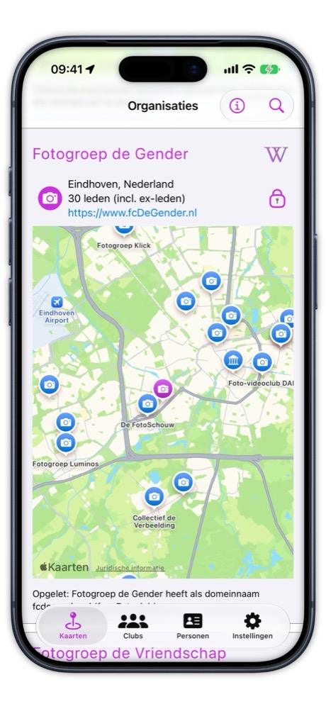

# Fotoclub Hub

[🇬🇧  English](README.md)

_Concept, 28 september 2026_

## Wat doet het?

Fotoclub Hub laat het werk van leden van fotoclubs zien aan mensen buiten hun club.
Zie het als een permanente online expositie, met een selectie van het beste werk van elke fotograaf.
Anders dan de meeste fotosites is het opgebouwd rond **clubs**, niet rond losse fotografen:
in een club komen fotografen al samen, bespreken ze elkaars werk en exposeren ze samen.
Je kunt een fotograaf ook direct opzoeken, maar je ziet hem of haar altijd als lid van een club.
Fotobond-leden die niet bij een club horen, krijgen een eigen plek.
De clubs leveren de gegevens aan en houden er volledig zelf zeggenschap over.

We willen meer bezoekers trekken dan clubwebsites, die tegenwoordig weinig bezocht worden.
En we willen een betere plek zijn om naar foto's te kijken dan sociale media, met al hun afleiding.

Fotoclub Hub bestaat als app voor iPhone en iPad, en als webversie die in elke browser werkt,
ook op een Android-telefoon en op een Windows- of Mac-computer.

## Waar staan we nu?

  
   
  <em>De kaart in de app, rond Eindhoven. Elke speld is een fotoclub (camera) of een museum (gebouw). 
  Clubs die je anders website voor website moet opzoeken, staan hier naast elkaar, één tik van elkaar.</em>

- De [app](https://apps.apple.com/nl/app/photo-club-hub/id1178324330) voor iPhone en iPad staat in de App Store
  van Apple en krijgt ongeveer eens per maand verbeteringen en reparaties.
- Een club kan de [webversie](https://www.fcdegender.nl/hub/nl/clubs/) met één link aan de eigen website toevoegen:
  op de [website van Fotogroep De Gender](https://www.fcdegender.nl/) leidt het menu-item "Ledenlijst" naar
  [de leden van de club in de webversie](https://www.fcdegender.nl/hub/nl/clubs/fgDeGender/).
- Een handvol clubs laat leden en portfolio's zien. Veel meer clubs staan al op de kaart, klaar voor de volgende stap.
  Voorlopig dekt de kaart twee afdelingen van de Fotobond: Brabant-Oost en Drenthe. De andere afdelingen volgen.
- Meerdere clubs hebben hun gegevens zelf ingevoerd, met behulp van een schriftelijke handleiding.
  We willen dat nog eenvoudiger maken.

## Waar gaat het naartoe?

Wat je vandaag ziet, is maar een deel van het idee. Hieronder staan ze naast elkaar.

| | Nu | Doel |
| --- | --- | --- |
| Clubs | Een handvol laat leden en foto's zien; veel meer staan op de kaart, voorlopig in twee afdelingen. | De meeste fotoclubs in Nederland laten het werk van hun leden zien, en geleidelijk doen ook clubs in andere landen mee. |
| Gegevens aanleveren | Clubs bewerken een gestructureerd bestand volgens een schriftelijke handleiding. Sommige lukt dat zelf, andere hebben hulp nodig. | Een club krijgt een formulier dat grotendeels al is ingevuld op basis van de eigen website. De club hoeft alleen te controleren en te corrigeren. |
| Actueel houden | Alleen als iemand een fout opmerkt en die laat herstellen. | Fotoclub Hub vergelijkt de gegevens met de website van de club en vraagt de club om wijzigingen te bevestigen. |
| Exposities | Fotoclub Hub toont nog geen exposities. Clubs kondigen ze aan op hun eigen website, maar de meeste mensen horen er via e-mail over: de secretaris van een club licht clubs in de buurt in, en die geven het misschien door aan hun leden. | De komende en eerdere exposities van elke club op één plek, in de app en op het web, zodat mensen exposities in de buurt vinden zonder op iemands mailinglijst te staan. De app kan je ook herinneren aan exposities van clubs in de buurt, of van clubs die je volgt. |
| Onderhoud van de software | Eén enthousiaste vrijwilliger, die het heeft ontworpen en gebouwd, grotendeels voordat er AI-programmeerassistenten bestonden. | Een paar vrijwilligers, die elk de onderdelen onderhouden die ze zelf hebben gebouwd of belangrijk vinden, met hulp van AI-assistenten. |

## Strategie om het op gang te brengen

<!-- Conceptdiagram, wordt nog opnieuw getekend. -->

- **Doorbreek het kip-en-ei-probleem.** Weinig clubs betekent weinig te zien. Weinig te zien betekent weinig gebruikers.
  Weinig gebruikers betekent weinig reden voor een club om mee te doen. Daarom wachten we niet tot clubs zich melden:
  we zetten ze vooraf op de kaart, afdeling voor afdeling. Een club kan dan instappen en, geholpen door slimme software,
  het verder oppakken.
- **Meedoen in kleine stappen.** Elk niveau voegt iets toe. Niveau 1: de club staat op de kaart.
  Niveau 2: de leden en hun interesses staan erbij. Niveau 3: hun portfolio's zijn te bekijken.
- **Laat de software het meeste typewerk doen.** Software is veel beter geworden in het lezen van wat een club al
  publiceert. In plaats van een bestand te bewerken en de fouten eruit te halen, krijgt een club de gegevens grotendeels
  ingevuld, en hoeft ze alleen te controleren en te corrigeren. Zover zijn we nog niet, maar daar gaan we wel naartoe.
- **Laat AI nieuwe ontwikkelaars helpen.** Instappen in een bestaand softwareproject betekende vroeger dagenlang je weg
  zoeken in de code. Een AI-assistent legt nu in seconden uit waar een waarde vandaan komt, wat een fout veroorzaakte,
  of waarom de bouw van de app klaagt. Zo kan een vrijwilliger in een paar uur een echte verbetering maken.

## Uitgangspunten

- **Gratis, en dat blijft zo.** Beide apps zijn gratis en blijven dat. Het project draait op vrijwilligers.
- **Open source.** Alle code staat openbaar op GitHub, onder de MIT-licentie.
- **Clubs zijn eigenaar van hun gegevens.** Een club kan de gegevens zelf hosten, of het project dat namens de club
  laten doen.
- **Foto's blijven bij de club.** Ze worden getoond vanaf de eigen website van de club en nooit gekopieerd.
- **Geen inlog.** Niemand hoeft zich aan te melden of een wachtwoord te onthouden, en er is geen centrale database die
  onderhoud nodig heeft. Wijzigingen in de gegevens lopen via versiebeheer: eerst voorgesteld, dan goedgekeurd.
- **Clubs eerst.** Zonder gegevens heeft de software geen waarde. Clubs erbij krijgen gaat dus voor alles, en alles
  wat daarbij helpt, zoals eenvoudiger gegevens invoeren, komt direct daarna. Eenvoudiger is beter: ingewikkelde
  technologie die complexiteit toevoegt, moet haar plek verdienen.
- **Gemaakt voor mensen die niet technisch zijn.** Veel clubleden zijn "wat ouder" en zijn lid geworden voor de
  fotografie, niet om met software te worstelen. Het moet dus aan de buitenkant eenvoudig zijn, ook als het daardoor
  aan de binnenkant ingewikkelder wordt.
- **Open voor elke club, waar ook ter wereld.** De huidige clubs zitten allemaal in Nederland, maar het ontwerp is
  internationaal. Een club hoeft nergens lid van te zijn, al zoeken we wel aansluiting bij organisaties zoals de
  Fotobond.
- **Andere apps zijn welkom.** Het gedeelde onderdeel "Data" kan worden gebruikt om andere apps te bouwen. Overleg
  met ons voordat je de naam Fotoclub Hub gebruikt, en vermeld Fotoclub Hub als je de gegevens gebruikt. Het
  auteursrecht op de foto's blijft bij de fotografen.

## Wie is eigenaar van wat

<!-- Conceptdiagram, wordt nog opnieuw getekend. De technische versie staat in de README van de Data-repository. -->

## Wat we je vragen

| Je bent | We vragen je om | Wat je ervoor terugkrijgt |
| --- | --- | --- |
| Een supporter | het uit te proberen, je club erover te vertellen, en ons te laten weten wat er ontbreekt | inspraak in wat er als volgende gebouwd wordt |
| Een ontwikkelaar | een ticket op te pakken, en het onderdeel dat je bouwde goed te houden | een echt project met echte gebruikers, in Swift, met serieus gebruik van AI-programmeerassistenten |
| De webmaster van een club | de ledenlijst van je club te publiceren, en die te verbeteren als iemand een fout vindt | het werk van je club zichtbaar buiten de club, en nieuwe mogelijkheden voor je website |
| Het bestuur van een club | in te stemmen met deelname, en een lid te vragen de gegevens aan te leveren | een gratis etalage voor de club en haar exposities |

## Meelezen, en meer informatie

- **[Het dashboard](https://github.com/vdhamer/Photo-Club-Hub-Project/discussions/14)** in de Discussions van deze
  repository laat zien waar aan gewerkt wordt, wat daarna komt, en hoe dat bepaald wordt. Je kunt erop reageren.
  Het dashboard is in het Engels.
- **Bericht ontvangen bij wijzigingen:** klik bovenaan deze pagina op Watch, of abonneer je alleen op het dashboard.
- **Geen git of code nodig:** met een gratis GitHub-account en een browser kun je reageren op een ticket of discussie.
- **`Good first issue`** markeert tickets die een nieuwkomer kan oppakken.
- **Alles hier is openbaar.** Zet daarom geen namen van clubleden in tickets of reacties.
- **Ticketnummers** schrijven we als `iOS#123`, `HTML#123`, `Data#123` of `Project#123`, naar de vier repositories:
  - [Photo-Club-Hub](https://github.com/vdhamer/Photo-Club-Hub): de app voor iPhone en iPad
  - [Photo-Club-Hub-HTML](https://github.com/vdhamer/Photo-Club-Hub-HTML): de Mac-app die de webversie maakt
  - [Photo-Club-Hub-Data](https://github.com/vdhamer/Photo-Club-Hub-Data): het deel dat beide apps delen
  - Photo-Club-Hub-Project (deze): de planning, en materiaal dat alle vier delen. Geen code.
- **Ontwikkelaars** vinden de code, hoe die gebouwd wordt en hoe je kunt bijdragen, in de README's van de eerste drie.
- **Meer documentatie**, in het Nederlands en het Engels, staat in de lijst in de
  [FAQ](https://github.com/vdhamer/Photo-Club-Hub/blob/main/Photo%20Club%20Hub/Documentation/FAQ_nl.md#er-is-vast-meer-documentatie):
  handleidingen voor clubs, de README's en de introductiepresentatie. Waar de gegevens staan en wat er gepland is,
  staat samengevat in een [overzicht op één scherm](https://github.com/vdhamer/Photo-Club-Hub-Data/issues/56) (Engels).
